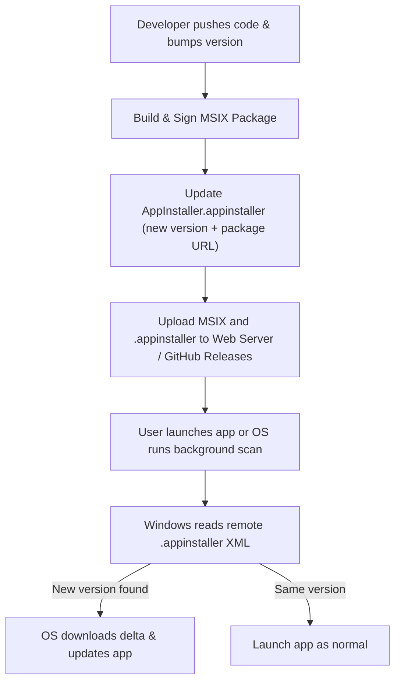

# Windows Native App Update Workflow: Step-by-Step Guide

This guide details how auto-updates work for native WinUI 3 / Windows App SDK applications, how to configure them, and the exact step-by-step publishing pipeline.

---

## 1. Update Strategy Decision Matrix

| Strategy | Packaging | Best For | How It Works | User Experience |
| :--- | :--- | :--- | :--- | :--- |
| **A. MSIX + `.appinstaller`** *(Recommended Native)* | Packaged (MSIX) | Independent web distribution, GitHub releases, enterprise sideloading. | Native Windows App Installer background service checks a remote URL on launch or interval. | Clean Windows dialog: *"An update is ready. Update now?"* or silent background update. |
| **B. Microsoft Store** | Packaged (MSIX) | Public commercial consumer distribution. | Store service updates the app automatically via Windows Update infrastructure. | Zero maintenance, completely silent or managed by Store. |
| **C. Velopack** | Unpackaged (Win32) | High-velocity GitHub desktop apps, custom auto-updaters without MSIX constraints. | Embedded C# library downloads binary deltas from GitHub releases or S3. | Fast, silent delta updates, restarts seamlessly. |

---

## 2. Recommended Native Strategy: MSIX + `.appinstaller`

The `.appinstaller` file is an XML manifest hosted on a web server or GitHub repository. Windows uses it to monitor for new `.msix` or `.msixbundle` files without requiring your app to write custom updater code.



---

## 3. Step-by-Step Setup: MSIX + `.appinstaller`

### Step 1: Configure App Identity & Manifest
In your project's `Package.appxmanifest`:
1. Open the manifest in Visual Studio.
2. Under **Packaging**:
   - **Package Name**: `YourCompany.YourApp`
   - **Publisher**: Must match the Subject Name on your code signing certificate (e.g., `CN=YourNameOrCompany`).
   - **Version**: Start with `1.0.0.0` (format: `Major.Minor.Build.Revision`).

---

### Step 2: Code Signing Certificate Setup
Windows requires all MSIX packages to be digitally signed before installation.

#### Option A: Development / Internal Testing (Self-Signed)
1. Run PowerShell as Administrator:
   ```powershell
   New-SelfSignedCertificate `
       -Type Custom `
       -Subject "CN=MyDevCert" `
       -KeyUsage DigitalSignature `
       -FriendlyName "My WinUI App Dev Cert" `
       -CertStoreLocation "Cert:\CurrentUser\My" `
       -TextExtension @("2.5.29.37={text}1.3.6.1.5.5.7.3.3")
   ```
2. Export the public certificate (`.cer`) and install it on target test machines under **Trusted People** (`Cert:\LocalMachine\TrustedPeople`).

#### Option B: Production (Trusted CA / Azure Trusted Signing)
Use a certificate from a trusted authority (e.g., DigiCert, Sectigo) or **Azure Trusted Signing** so end users do not need to install certificates manually.

---

### Step 3: Create the `AppInstaller.appinstaller` File
Create an XML file named `MyApp.appinstaller` and place it at the root of your web hosting location:

```xml
<?xml version="1.0" encoding="utf-8"?>
<AppInstaller 
    xmlns="http://schemas.microsoft.com/appx/appinstaller/2021"
    Version="1.0.0.0"
    Uri="https://updates.yourdomain.com/MyApp.appinstaller">

    <MainPackage
        Name="YourCompany.YourApp"
        Publisher="CN=YourNameOrCompany"
        Version="1.0.0.0"
        ProcessorArchitecture="x64"
        Uri="https://updates.yourdomain.com/packages/MyApp_1.0.0.0_x64.msix" />

    <UpdateSettings>
        <!-- Check for updates on every app launch -->
        <OnLaunch HoursBetweenUpdateChecks="0" ShowPrompt="true" UpdateBlocksActivation="false" />
        
        <!-- Automatic background check every 6 hours -->
        <AutomaticBackgroundTask />
        
        <!-- Force update if breaking changes occur -->
        <ForceUpdateFromAnyVersion>false</ForceUpdateFromAnyVersion>
    </UpdateSettings>
</AppInstaller>
```

#### Explanation of `UpdateSettings`:
- `HoursBetweenUpdateChecks="0"`: Checks the web endpoint every time the user launches the application.
- `ShowPrompt="true"`: Asks the user if they want to update before launching. If `false`, updates silently in the background for the *next* launch.
- `UpdateBlocksActivation="false"`: Lets the user open the app immediately while the update downloads in the background.

---

### Step 4: Web Server / CDN Configuration
Ensure your hosting server serves correct MIME types for MSIX files:

| File Extension | MIME Type |
| :--- | :--- |
| `.appinstaller` | `application/appinstaller` |
| `.msix` | `application/msix` |
| `.msixbundle` | `application/msixbundle` |

> [!NOTE]
> If using GitHub Pages or static blob storage (Azure Blob, AWS S3), ensure headers include `Content-Disposition: inline` and matching MIME types.

---

### Step 5: Programmatic In-App Update Checking (C#)
Allow users to manually click **"Check for updates"** in the Settings Page (like Windows Settings):

#### In `Services/UpdateService.cs`:
```csharp
using System;
using System.Threading.Tasks;
using Windows.ApplicationModel;
using Windows.Management.Deployment;

namespace MyNativeApp.Services;

public class UpdateService : IUpdateService
{
    public async Task<UpdateCheckResult> CheckForUpdatesAsync()
    {
        try
        {
            var package = Package.Current;
            var result = await package.CheckUpdateAvailabilityAsync();

            return result.Availability switch
            {
                PackageUpdateAvailability.Available => UpdateCheckResult.Available,
                PackageUpdateAvailability.Required => UpdateCheckResult.Required,
                PackageUpdateAvailability.NoUpdates => UpdateCheckResult.UpToDate,
                PackageUpdateAvailability.Unknown => UpdateCheckResult.Error,
                _ => UpdateCheckResult.Error
            };
        }
        catch (Exception ex)
        {
            // Logging
            return UpdateCheckResult.Error;
        }
    }
}

public enum UpdateCheckResult
{
    UpToDate,
    Available,
    Required,
    Error
}
```

#### Wire to the Settings ViewModel:
```csharp
[RelayCommand]
private async Task CheckUpdatesAsync()
{
    IsCheckingUpdates = true;
    UpdateStatusMessage = "Checking for updates...";

    var status = await _updateService.CheckForUpdatesAsync();

    UpdateStatusMessage = status switch
    {
        UpdateCheckResult.UpToDate => "You are running the latest version.",
        UpdateCheckResult.Available => "An update is available! Restart the app to apply.",
        _ => "Unable to check for updates at this time."
    };

    IsCheckingUpdates = false;
}
```

---

## 4. Releasing an Update: Step-by-Step Routine

Follow this exact sequence each time you ship a new version:

### 1. Bump the Version
In your `.csproj` and `Package.appxmanifest`:
- Change `1.0.0.0` -> `1.0.1.0`.

### 2. Build and Package
Run in developer command line or PowerShell:
```powershell
dotnet publish -c Release `
    -r win-x64 `
    /p:GenerateAppxPackageOnBuild=true `
    /p:AppxPackageDir="bin\Dist\" `
    /p:AppxPackageSigningEnabled=true `
    /p:PackageCertificateThumbprint="<YOUR_CERT_THUMBPRINT>"
```

### 3. Update the `.appinstaller` Manifest
Edit `MyApp.appinstaller`:
```xml
<AppInstaller ... Version="1.0.1.0">
    <MainPackage ... 
        Version="1.0.1.0"
        Uri="https://updates.yourdomain.com/packages/MyApp_1.0.1.0_x64.msix" />
    ...
</AppInstaller>
```

### 4. Upload Files
Upload to your CDN or release server:
1. `MyApp_1.0.1.0_x64.msix` -> `https://updates.yourdomain.com/packages/`
2. `MyApp.appinstaller` -> `https://updates.yourdomain.com/MyApp.appinstaller`

### 5. Client Update Trigger
- Users who open the app will trigger the launch check.
- Windows will automatically fetch `MyApp.appinstaller`, detect `1.0.1.0 > 1.0.0.0`, download the delta diff, and apply the update.

---

## 5. Alternative Strategy: Velopack (For Unpackaged Apps)

If you configure your WinUI 3 project as **Unpackaged** (`<WindowsPackageType>None</WindowsPackageType>`), use **Velopack**:

### 1. Install Velopack
```bash
dotnet add package Velopack
dotnet tool install -g vpk
```

### 2. Add App Startup Hook in `App.xaml.cs`
```csharp
public App()
{
    // Must be first line before UI initialization
    VelopackApp.Build().Run();
    InitializeComponent();
}
```

### 3. Update Check in ViewModel / Service
```csharp
using Velopack;
using Velopack.Sources;

public async Task CheckVelopackUpdateAsync()
{
    var mgr = new UpdateManager(new GithubSource("https://github.com/YourOrg/YourRepo", null, false));
    
    // Check for updates
    var newVersion = await mgr.CheckForUpdatesAsync();
    if (newVersion is null) return; // Up to date

    // Download update deltas
    await mgr.DownloadUpdatesAsync(newVersion);

    // Apply and restart
    mgr.ApplyUpdatesAndRestart(newVersion);
}
```

### 4. Pack with Velopack CLI
```bash
dotnet publish -c Release -r win-x64 -o ./publish
vpk pack -u YourAppName -v 1.0.1 -p ./publish -e YourApp.exe
```
This produces a `releases` directory ready to be uploaded to GitHub Releases.

---

## 6. Summary Checklist Before Going to Production

- [ ] Digital signing certificate obtained and configured in build pipeline.
- [ ] `AppInstaller.appinstaller` URL points to the permanent HTTPS domain.
- [ ] Web host serves correct MIME types for `.appinstaller` and `.msix`.
- [ ] `CheckUpdateAvailabilityAsync()` wired to Settings UI for manual checks.
- [ ] CI/CD pipeline automated to increment version, sign package, and publish `.appinstaller`.
